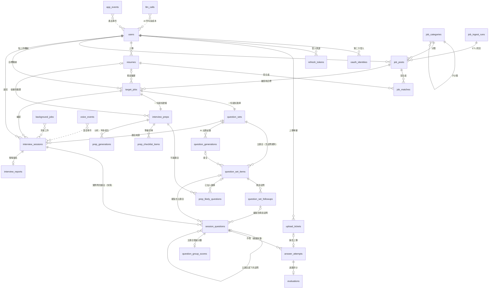
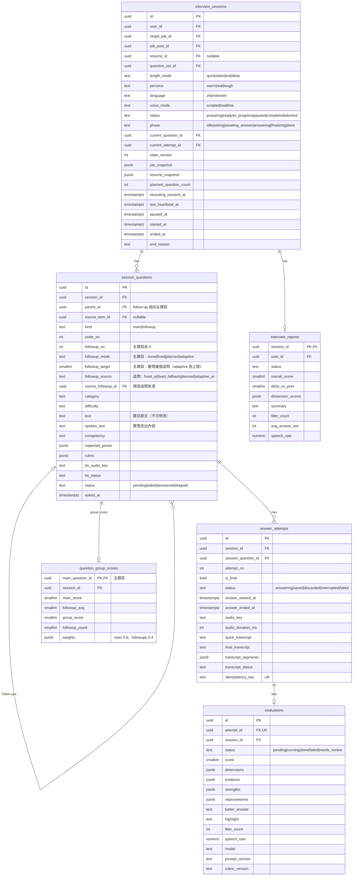
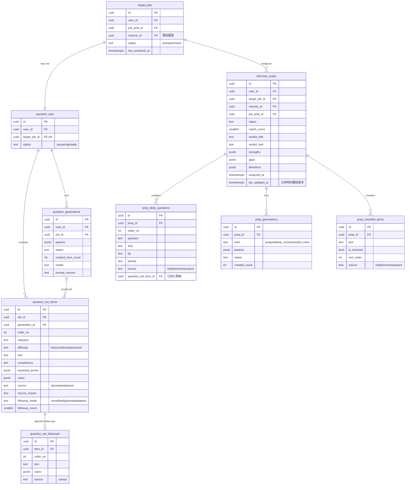
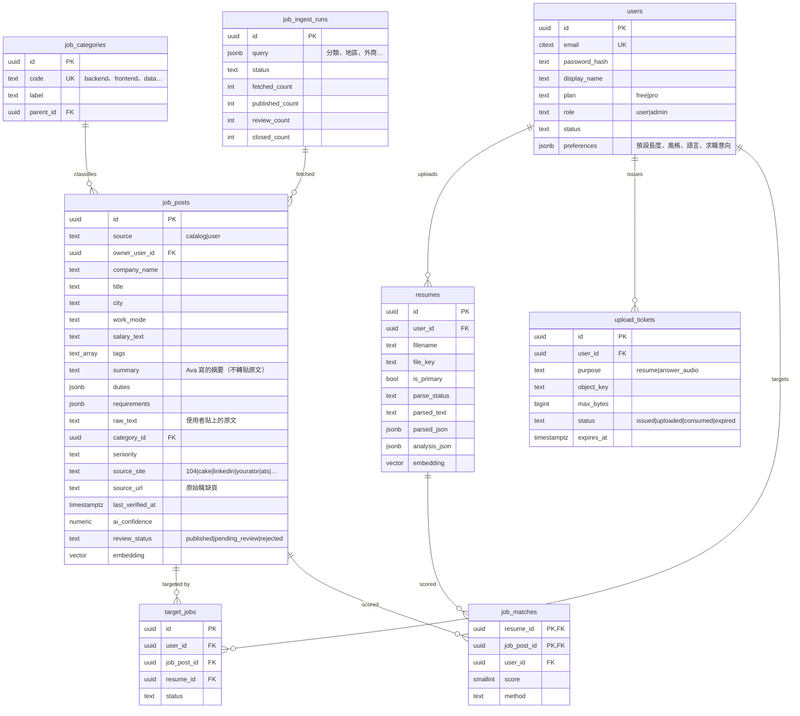

# AI Interview — PostgreSQL 資料庫規格書

> 版本：v0.4・資料庫：PostgreSQL 16＋`pgvector`、`pg_trgm`、`citext`
> v0.4 新增：追問規則（`question_set_followups`、整組分數 `question_group_scores`）、直接上傳單據（`upload_tickets`）、職缺分類與 ETL（`job_categories`、`job_ingest_runs`、`job_posts` 來源與審核欄位）
> 相關文件：[architecture.md](architecture.md)・[api.md](api.md)・[flows.md](flows.md)

---

## 1. 設計原則

1. **快照優先**：面試開始時，把職缺、履歷、題目**複製**進場次（`job_snapshot`、`resume_snapshot`、`session_questions`）。使用者日後修改，舊報告不變。
2. **可編輯的草稿與凍結的紀錄分開**：`question_set_items` 是可編輯的題庫；`session_questions` 是某場面試**實際播放的題目**，建立後不可修改。
3. **狀態推進用樂觀鎖**：`interview_sessions.state_version` 每次推進 +1，更新時必須帶上預期版本。
4. **冪等**：回答上傳、背景工作都帶冪等鍵（`idempotency_key`、`dedupe_key`）。API 層的通用冪等快取放 Redis，但**回答上傳**另有資料庫唯一約束兜底。
5. **列舉值用 `text + CHECK`**，不用 PostgreSQL `ENUM`（新增值不必改型別，遷移較單純）。
6. **主鍵**：業務表用 `uuid`（`gen_random_uuid()`）；Log 類大表用 `bigint identity`，並按月分區。
7. **時間**一律 `timestamptz`，儲存 UTC。
8. **AI 結構化輸出**存 `jsonb`，但**查詢與排序會用到的欄位**（分數、狀態）獨立成一般欄位。
9. **軟刪除**只用在使用者可見、可能需要復原的內容（履歷、職缺、題目）；個資刪除請求一律硬刪除。
10. **PostgreSQL 是唯一真實來源**：Redis（佇列、快取、鎖、冪等鍵）裡的資料都必須能從 PostgreSQL 重建或可以遺失，見 [architecture.md §4.3](architecture.md)。
11. **目標職缺是練習的單位**：使用者把職缺加入「目標職缺」（`target_jobs`）後，系統自動建立它的題組（一對一）與面試建議；面試、報告都掛在目標職缺下。
12. **履歷是個人資料的唯一來源**：經歷、技能、成果都從履歷解析（`resumes.parsed_json`），不另外讓使用者填寫表單。

---

## 2. ER 圖

### 2.1 全貌（全部資料表）

以「目標職缺」為中心：每個目標職缺一份面試題庫、一份面試建議，以及多場面試；每場面試一份報告。Log 類資料表（`llm_calls`、`voice_events`、`app_events`）刻意不加外鍵，圖中以虛線表示。



### 2.2 核心：面試與評分（含欄位）



### 2.3 題庫與面試建議（含欄位）



### 2.4 使用者、履歷與職缺（含欄位）



---

## 3. 資料表清單

| 領域 | 資料表 | 說明 | 對應 UI |
|---|---|---|---|
| 帳號 | `users` | 帳號、方案、狀態 | 登入 |
| | `oauth_identities` | Google 等第三方登入 | 登入 |
| | `refresh_tokens` | Refresh token 雜湊、輪替 | — |
| | （`users.preferences`） | 預設面試長度／風格／語言、求職意向 | 設定 |
| 上傳 | `upload_tickets` | 直接上傳到物件儲存的單據（履歷、回答錄音），用來驗證檔案 | 上傳前 |
| 履歷 | `resumes` | 履歷原檔位置、解析結果（經歷、技能、成果）、AI 建議、embedding | 設定・履歷 |
| 職缺 | `job_posts` | 平台職缺（ETL、匯入）與使用者貼上的職缺；平台職缺必有原始網址與審核狀態 | 職缺搜尋 |
| | `job_categories` | 職能分類（可分層） | 職缺搜尋・篩選 |
| | `job_ingest_runs` | 每次職缺 ETL 的條件與統計 | 後台・資料管線 |
| | `target_jobs` | 目標職缺：使用者正在準備的職缺，記住預設履歷 | 側欄・目標職缺 |
| | `job_matches` | 履歷×職缺契合度快取 | 職缺・契合度 |
| 準備 | `interview_preps` | 面試建議分析結果（每個目標職缺一份，重新分析時更新） | 面試建議 |
| | `prep_likely_questions` | 可能被問的題目（只附加不刪除，可加入題組） | 面試建議・可能題目 |
| | `prep_checklist_items` | 準備清單與勾選狀態（只附加不刪除） | 面試建議・清單 |
| | `prep_generations` | 一次分析或「再多產生」的工作與參數 | 面試建議・重新分析／再多產生 |
| 題組 | `question_sets` | 題組，與目標職缺一對一 | 題庫生成 |
| | `question_set_items` | 題組中的主題目（可編輯、排序），含追問規則 | 題庫生成・題目列 |
| | `question_set_followups` | 主題目底下的預設追問（追問規則 = planned 時使用） | 題庫生成・預設追問 |
| | `question_generations` | 一次 AI 生成工作與參數 | 題庫生成・輸入框 |
| 面試 | `interview_sessions` | 一場面試、狀態機（可暫停、24 小時內繼續） | 新面試、面試進行中 |
| | `session_questions` | 該場**實際使用**的主題目與追問（快照） | 進度、題目 |
| | `answer_attempts` | 每次作答：音訊、即時與最終逐字稿（重錄會產生新的一筆） | 逐字稿 |
| 評分 | `evaluations` | 逐題評分與建議（主題目、追問各自一筆） | 報告・逐題回顧 |
| | `question_group_scores` | 每道主題目的整組分數（主題目＋追問） | 報告・整組分數 |
| | `interview_reports` | 整場報告 | 面試報告 |
| 系統 | `background_jobs` | 背景工作 outbox 與執行紀錄（實際佇列在 Redis／arq） | — |
| Log | `llm_calls` | AI 呼叫與成本（月分區） | — |
| | `voice_events` | 語音事件：播放、自動播放被擋、Realtime 連線與降級（月分區） | — |
| | `app_events` | 產品事件與稽核（月分區） | — |

---

## 4. DDL

### 4.1 擴充與共用

```sql
CREATE EXTENSION IF NOT EXISTS citext;
CREATE EXTENSION IF NOT EXISTS pg_trgm;
CREATE EXTENSION IF NOT EXISTS vector;     -- pgvector
-- gen_random_uuid() 自 PostgreSQL 13 起內建

CREATE OR REPLACE FUNCTION set_updated_at() RETURNS trigger AS $$
BEGIN NEW.updated_at = now(); RETURN NEW; END $$ LANGUAGE plpgsql;
-- 每張含 updated_at 的表都掛：
-- CREATE TRIGGER trg_<table>_updated BEFORE UPDATE ON <table> FOR EACH ROW EXECUTE FUNCTION set_updated_at();
```

### 4.2 帳號與個人檔案

```sql
CREATE TABLE users (
  id                 uuid PRIMARY KEY DEFAULT gen_random_uuid(),
  email              citext NOT NULL UNIQUE,
  password_hash      text,                                   -- 僅 OAuth 登入者為 NULL
  display_name       text NOT NULL,
  avatar_key         text,
  plan               text NOT NULL DEFAULT 'free' CHECK (plan IN ('free','pro')),
  role               text NOT NULL DEFAULT 'user' CHECK (role IN ('user','admin')),
  status             text NOT NULL DEFAULT 'active' CHECK (status IN ('active','suspended','deleted')),
  locale             text NOT NULL DEFAULT 'zh-TW',
  preferences        jsonb NOT NULL DEFAULT '{}',              -- 見 §5；新面試頁的預設值
  email_verified_at  timestamptz,
  last_login_at      timestamptz,
  created_at         timestamptz NOT NULL DEFAULT now(),
  updated_at         timestamptz NOT NULL DEFAULT now()
);

CREATE TABLE oauth_identities (
  id                uuid PRIMARY KEY DEFAULT gen_random_uuid(),
  user_id           uuid NOT NULL REFERENCES users(id) ON DELETE CASCADE,
  provider          text NOT NULL CHECK (provider IN ('google')),
  provider_user_id  text NOT NULL,
  created_at        timestamptz NOT NULL DEFAULT now(),
  UNIQUE (provider, provider_user_id)
);

CREATE TABLE refresh_tokens (
  id          uuid PRIMARY KEY DEFAULT gen_random_uuid(),
  user_id     uuid NOT NULL REFERENCES users(id) ON DELETE CASCADE,
  family_id   uuid NOT NULL,                 -- 同一登入鏈；偵測到重放時整個 family 撤銷
  token_hash  text NOT NULL UNIQUE,          -- SHA-256，不存明文
  expires_at  timestamptz NOT NULL,
  revoked_at  timestamptz,
  user_agent  text,
  ip          inet,
  created_at  timestamptz NOT NULL DEFAULT now()
);
CREATE INDEX ix_refresh_tokens_user ON refresh_tokens(user_id) WHERE revoked_at IS NULL;

-- 不另外建 user_profiles / user_skills / work_experiences：
-- 經歷、技能、成果一律從履歷解析（resumes.parsed_json），使用者不用重複填寫；
-- 名稱在 users.display_name，偏好與求職意向在 users.preferences。
```

### 4.3 上傳單據與履歷

```sql
-- 直接上傳：API 只發「上傳單據」與預簽名網址，檔案不經過 API
CREATE TABLE upload_tickets (
  id            uuid PRIMARY KEY DEFAULT gen_random_uuid(),
  user_id       uuid NOT NULL REFERENCES users(id) ON DELETE CASCADE,
  purpose       text NOT NULL CHECK (purpose IN ('resume','answer_audio')),
  object_key    text NOT NULL UNIQUE,         -- users/{uid}/uploads/{id}
  content_type  text NOT NULL,
  max_bytes     bigint NOT NULL,
  attempt_id    uuid,                         -- purpose = answer_audio 時對應的作答（FK 於 §4.7 補上）
  status        text NOT NULL DEFAULT 'issued' CHECK (status IN ('issued','uploaded','consumed','expired')),
  expires_at    timestamptz NOT NULL,         -- 網址 5 分鐘有效；單據 1 小時內沒使用就清除物件
  consumed_at   timestamptz,
  created_at    timestamptz NOT NULL DEFAULT now()
);
CREATE INDEX ix_upload_tickets_cleanup ON upload_tickets(expires_at) WHERE status IN ('issued','uploaded');

CREATE TABLE resumes (
  id             uuid PRIMARY KEY DEFAULT gen_random_uuid(),
  user_id        uuid NOT NULL REFERENCES users(id) ON DELETE CASCADE,
  filename       text NOT NULL,
  mime_type      text NOT NULL,
  size_bytes     int  NOT NULL CHECK (size_bytes <= 10 * 1024 * 1024),
  file_key       text NOT NULL,              -- users/{user_id}/resumes/{id}.pdf
  sha256         text NOT NULL,
  is_primary     boolean NOT NULL DEFAULT false,
  parse_status   text NOT NULL DEFAULT 'pending'
                 CHECK (parse_status IN ('pending','parsing','parsed','failed')),
  parsed_text    text,
  parsed_json    jsonb,                      -- 基本資料、經歷、技能、專案、量化成果
  analysis_json  jsonb,                      -- {highlights:[], improvements:[]}
  embedding      vector(1536),               -- 維度依 EMBEDDING_MODEL 調整
  parse_error    text,
  created_at     timestamptz NOT NULL DEFAULT now(),
  updated_at     timestamptz NOT NULL DEFAULT now(),
  deleted_at     timestamptz
);
CREATE INDEX ix_resumes_user ON resumes(user_id, created_at DESC) WHERE deleted_at IS NULL;
CREATE UNIQUE INDEX uq_resumes_primary ON resumes(user_id) WHERE is_primary AND deleted_at IS NULL;
```

### 4.4 職缺

```sql
-- 職能分類（可分層，例如 engineering > backend）；ETL 與篩選都用這張表
CREATE TABLE job_categories (
  id          uuid PRIMARY KEY DEFAULT gen_random_uuid(),
  code        text NOT NULL UNIQUE,             -- backend、frontend、data、pm、design…
  label       text NOT NULL,                    -- 後端工程
  parent_id   uuid REFERENCES job_categories(id),
  sort_order  int NOT NULL DEFAULT 0,
  is_active   boolean NOT NULL DEFAULT true
);

-- 每次職缺 ETL 的查詢條件與結果統計
CREATE TABLE job_ingest_runs (
  id               uuid PRIMARY KEY DEFAULT gen_random_uuid(),
  query            jsonb NOT NULL,              -- {category:"backend", region:"台北市", foreign:true, language:"en"}
  status           text NOT NULL DEFAULT 'running' CHECK (status IN ('running','succeeded','failed')),
  fetched_count    int NOT NULL DEFAULT 0,      -- 搜尋抓回
  valid_count      int NOT NULL DEFAULT 0,      -- 通過程式驗證
  published_count  int NOT NULL DEFAULT 0,      -- 自動上架
  review_count     int NOT NULL DEFAULT 0,      -- 送審
  closed_count     int NOT NULL DEFAULT 0,      -- 定期檢查下架
  cost_usd         numeric(10,4),
  error            text,
  started_at       timestamptz NOT NULL DEFAULT now(),
  finished_at      timestamptz
);

CREATE TABLE job_posts (
  id               uuid PRIMARY KEY DEFAULT gen_random_uuid(),
  source           text NOT NULL CHECK (source IN ('catalog','user')),
  owner_user_id    uuid REFERENCES users(id) ON DELETE CASCADE,
  external_ref     text,                     -- 匯入來源的 ID
  company_name     text NOT NULL,
  company_logo_key text,
  title            text NOT NULL,
  city             text,                     -- 台北市、新竹市…（篩選用）
  location_text    text,                     -- 台北市信義區
  employment_type  text,                     -- 全職、兼職…
  work_mode        text CHECK (work_mode IN ('onsite','hybrid','remote')),
  work_mode_note   text,                     -- 每週 2 天遠端
  salary_text      text,
  salary_min       int,
  salary_max       int,
  salary_period    text CHECK (salary_period IN ('month','year')),
  tags             text[] NOT NULL DEFAULT '{}',
  about            text,                     -- 使用者貼上職缺時的「關於」
  summary          text,                     -- 平台職缺：Ava 寫的 2–3 句摘要（不轉貼原文）
  duties           jsonb NOT NULL DEFAULT '[]',   -- 平台職缺為 Ava 改寫的重點條列
  requirements     jsonb NOT NULL DEFAULT '[]',
  category_id      uuid REFERENCES job_categories(id),
  seniority        text CHECK (seniority IN ('junior','mid','senior','lead')),
  source_site      text,                     -- 104、cake、linkedin、yourator、greenhouse、lever、company…
  source_url       text,                     -- 原始職缺頁（詳情的「前往原始職缺頁」）
  source_url_norm  text,                     -- 正規化網址（去除追蹤參數），用來去重
  ingest_run_id    uuid REFERENCES job_ingest_runs(id) ON DELETE SET NULL,
  fetched_at       timestamptz,
  last_verified_at timestamptz,              -- 最近一次確認原始網址仍有效
  ai_confidence    numeric(3,2),             -- 分類與內容的信心分數 0–1
  review_status    text NOT NULL DEFAULT 'published'
                   CHECK (review_status IN ('published','pending_review','rejected')),
  review_reasons   jsonb NOT NULL DEFAULT '[]',   -- ["分類信心低","公司名稱與網域不一致"]
  work_language    text,                     -- zh / en
  is_foreign       boolean NOT NULL DEFAULT false,
  raw_text         text,                     -- 職缺原文：使用者貼上的 JD；平台職缺為爬蟲取得的描述（只給 AI 出題與分析用，API 不回傳平台職缺的原文）
  parse_status     text NOT NULL DEFAULT 'parsed'
                   CHECK (parse_status IN ('pending','parsing','parsed','failed')),
  search_text      text NOT NULL DEFAULT '', -- 職稱+公司+標籤，應用程式維護
  embedding        vector(1536),
  status           text NOT NULL DEFAULT 'active' CHECK (status IN ('draft','active','closed')),
  posted_at        timestamptz,
  created_at       timestamptz NOT NULL DEFAULT now(),
  updated_at       timestamptz NOT NULL DEFAULT now(),
  deleted_at       timestamptz,
  CHECK ((source = 'user') = (owner_user_id IS NOT NULL)),
  CHECK (source <> 'catalog' OR source_url IS NOT NULL)    -- 平台職缺一定要有原始職缺頁
);
CREATE UNIQUE INDEX uq_job_posts_source ON job_posts(source_site, external_ref) WHERE external_ref IS NOT NULL;
CREATE UNIQUE INDEX uq_job_posts_url    ON job_posts(source_url_norm) WHERE source_url_norm IS NOT NULL AND deleted_at IS NULL;
CREATE INDEX ix_job_posts_review   ON job_posts(review_status, fetched_at) WHERE review_status = 'pending_review';
CREATE INDEX ix_job_posts_verify   ON job_posts(last_verified_at) WHERE source = 'catalog' AND status = 'active';
CREATE INDEX ix_job_posts_category ON job_posts(category_id, seniority) WHERE status = 'active' AND review_status = 'published';
CREATE INDEX ix_job_posts_catalog ON job_posts(status, posted_at DESC) WHERE source = 'catalog' AND deleted_at IS NULL;
CREATE INDEX ix_job_posts_owner   ON job_posts(owner_user_id, created_at DESC) WHERE source = 'user' AND deleted_at IS NULL;
CREATE INDEX ix_job_posts_city    ON job_posts(city);
CREATE INDEX ix_job_posts_search  ON job_posts USING gin (search_text gin_trgm_ops);
CREATE INDEX ix_job_posts_tags    ON job_posts USING gin (tags);
CREATE INDEX ix_job_posts_emb     ON job_posts USING hnsw (embedding vector_cosine_ops);

-- 目標職缺：使用者正在準備的職缺。加入時系統自動建立題組並產生面試建議
CREATE TABLE target_jobs (
  id                 uuid PRIMARY KEY DEFAULT gen_random_uuid(),
  user_id            uuid NOT NULL REFERENCES users(id) ON DELETE CASCADE,
  job_post_id        uuid NOT NULL REFERENCES job_posts(id) ON DELETE CASCADE,
  resume_id          uuid REFERENCES resumes(id) ON DELETE SET NULL,   -- 這個職缺預設用的履歷，可為空（沒有履歷也能練）
  status             text NOT NULL DEFAULT 'active' CHECK (status IN ('active','archived')),
  last_practiced_at  timestamptz,
  created_at         timestamptz NOT NULL DEFAULT now(),
  updated_at         timestamptz NOT NULL DEFAULT now(),
  UNIQUE (user_id, job_post_id)
);
CREATE INDEX ix_target_jobs_user ON target_jobs(user_id, last_practiced_at DESC NULLS LAST) WHERE status = 'active';
-- 「移出目標職缺」= status 改為 archived；題組與報告都保留，重新加入就能找回

CREATE TABLE job_matches (
  resume_id    uuid NOT NULL REFERENCES resumes(id) ON DELETE CASCADE,
  job_post_id  uuid NOT NULL REFERENCES job_posts(id) ON DELETE CASCADE,
  user_id      uuid NOT NULL REFERENCES users(id) ON DELETE CASCADE,
  score        smallint NOT NULL CHECK (score BETWEEN 0 AND 100),
  method       text NOT NULL CHECK (method IN ('embedding','llm')),
  rationale    jsonb,
  computed_at  timestamptz NOT NULL DEFAULT now(),
  PRIMARY KEY (resume_id, job_post_id)
);
CREATE INDEX ix_job_matches_rank ON job_matches(resume_id, score DESC);
```

### 4.5 面試建議

```sql
CREATE TABLE interview_preps (
  id                uuid PRIMARY KEY DEFAULT gen_random_uuid(),
  user_id           uuid NOT NULL REFERENCES users(id) ON DELETE CASCADE,
  target_job_id     uuid NOT NULL UNIQUE REFERENCES target_jobs(id) ON DELETE CASCADE,   -- 每個目標職缺一份；重新分析時更新這一列
  resume_id         uuid REFERENCES resumes(id),          -- 上次分析用的履歷；沒有履歷時只依職缺分析
  job_post_id       uuid NOT NULL REFERENCES job_posts(id),
  status            text NOT NULL DEFAULT 'pending'
                    CHECK (status IN ('pending','running','ready','failed')),
  match_score       smallint CHECK (match_score BETWEEN 0 AND 100),
  verdict_title     text,                    -- 整體很適合你
  verdict_text      text,
  strengths         jsonb,                   -- ["3 年 React 經驗…"]
  gaps              jsonb,                   -- ["履歷沒有寫到帶人…"]
  directions        jsonb,                   -- [{"label":"React 效能優化","probability":92}]
  analyzed_at       timestamptz,             -- 上次分析完成時間（依據卡片顯示）
  job_updated_at    timestamptz,             -- 分析時職缺的 updated_at；之後職缺有改就提示重新分析
  model             text,
  prompt_version    text,
  error             text,
  created_at        timestamptz NOT NULL DEFAULT now(),
  updated_at        timestamptz NOT NULL DEFAULT now()
);

-- 「重新分析」與「再多產生」的工作紀錄（同一份 prep 同時只能有一個進行中）
CREATE TABLE prep_generations (
  id             uuid PRIMARY KEY DEFAULT gen_random_uuid(),
  prep_id        uuid NOT NULL REFERENCES interview_preps(id) ON DELETE CASCADE,
  kind           text NOT NULL CHECK (kind IN ('analyze','likely_more','checklist_more')),
  params         jsonb NOT NULL DEFAULT '{}',   -- {note, category, count, resume_id}
  status         text NOT NULL DEFAULT 'pending' CHECK (status IN ('pending','running','succeeded','failed')),
  created_count  int NOT NULL DEFAULT 0,
  model          text,
  prompt_version text,
  error          text,
  created_at     timestamptz NOT NULL DEFAULT now(),
  finished_at    timestamptz
);
CREATE UNIQUE INDEX uq_prep_generation_running ON prep_generations(prep_id) WHERE status IN ('pending','running');

-- 可能被問的題目：只附加，不刪除
CREATE TABLE prep_likely_questions (
  id                    uuid PRIMARY KEY DEFAULT gen_random_uuid(),
  prep_id               uuid NOT NULL REFERENCES interview_preps(id) ON DELETE CASCADE,
  generation_id         uuid REFERENCES prep_generations(id) ON DELETE SET NULL,
  order_no              int NOT NULL,
  question              text NOT NULL,
  why                   text,
  tip                   text,
  priority              text NOT NULL CHECK (priority IN ('high','medium','low')),
  source                text NOT NULL CHECK (source IN ('initial','more','reanalyze')),
  question_set_item_id  uuid,                          -- 已加入題組；FK 於 §4.6 建立題組表後補上
  created_at            timestamptz NOT NULL DEFAULT now(),
  UNIQUE (prep_id, order_no)
);
CREATE INDEX ix_prep_likely_text_trgm ON prep_likely_questions USING gin (question gin_trgm_ops);  -- 產生時去重

CREATE TABLE prep_checklist_items (
  id             uuid PRIMARY KEY DEFAULT gen_random_uuid(),
  prep_id        uuid NOT NULL REFERENCES interview_preps(id) ON DELETE CASCADE,
  generation_id  uuid REFERENCES prep_generations(id) ON DELETE SET NULL,
  text           text NOT NULL,
  is_checked     boolean NOT NULL DEFAULT false,
  sort_order     int NOT NULL,
  source         text NOT NULL DEFAULT 'initial' CHECK (source IN ('initial','more','reanalyze')),
  created_at     timestamptz NOT NULL DEFAULT now(),
  updated_at     timestamptz NOT NULL DEFAULT now()
);
CREATE INDEX ix_prep_checklist ON prep_checklist_items(prep_id, sort_order);
```

### 4.6 題庫

```sql
-- 題組：每個目標職缺剛好一組（MVP 不支援一個職缺多組，介面與 API 都比較單純）
CREATE TABLE question_sets (
  id             uuid PRIMARY KEY DEFAULT gen_random_uuid(),
  user_id        uuid NOT NULL REFERENCES users(id) ON DELETE CASCADE,
  target_job_id  uuid NOT NULL UNIQUE REFERENCES target_jobs(id) ON DELETE CASCADE,
  status         text NOT NULL DEFAULT 'preparing' CHECK (status IN ('preparing','ready')),  -- 加入目標職缺後自動出第一組題目
  created_at     timestamptz NOT NULL DEFAULT now(),
  updated_at     timestamptz NOT NULL DEFAULT now()
);

CREATE TABLE question_generations (
  id                  uuid PRIMARY KEY DEFAULT gen_random_uuid(),
  user_id             uuid NOT NULL REFERENCES users(id) ON DELETE CASCADE,
  set_id              uuid NOT NULL REFERENCES question_sets(id) ON DELETE CASCADE,
  params              jsonb NOT NULL,        -- {categories:[], difficulty, count, note}
  status              text NOT NULL DEFAULT 'pending'
                      CHECK (status IN ('pending','running','succeeded','failed')),
  created_item_count  int NOT NULL DEFAULT 0,
  model               text,
  prompt_version      text,
  error               text,
  created_at          timestamptz NOT NULL DEFAULT now(),
  finished_at         timestamptz
);

CREATE TABLE question_set_items (
  id               uuid PRIMARY KEY DEFAULT gen_random_uuid(),
  set_id           uuid NOT NULL REFERENCES question_sets(id) ON DELETE CASCADE,
  generation_id    uuid REFERENCES question_generations(id) ON DELETE SET NULL,
  order_no         int  NOT NULL,
  category         text NOT NULL,            -- 自我介紹、技術深度、系統設計、團隊合作、情境題、動機與規劃、自訂
  difficulty       text NOT NULL CHECK (difficulty IN ('basic','medium','advanced')),
  text             text NOT NULL CHECK (length(text) BETWEEN 1 AND 500),
  competency       text,                     -- 考察能力
  expected_points  jsonb NOT NULL DEFAULT '[]',
  rubric           jsonb,                    -- 評分規準，使用者自訂題目時由 AI 補
  source           text NOT NULL CHECK (source IN ('ai','user','prep','report')),
  source_reason    text,                     -- 為何針對此職缺／履歷出這題
  followup_mode    text NOT NULL DEFAULT 'adaptive'
                   CHECK (followup_mode IN ('none','fixed','planned','adaptive')),
  followup_count   smallint NOT NULL DEFAULT 1,   -- fixed：固定次數（1–3）；adaptive：上限（1–2）；planned 與 none 不使用
  created_at       timestamptz NOT NULL DEFAULT now(),
  updated_at       timestamptz NOT NULL DEFAULT now(),
  deleted_at       timestamptz,
  CHECK (followup_mode <> 'fixed'    OR followup_count BETWEEN 1 AND 3),
  CHECK (followup_mode <> 'adaptive' OR followup_count BETWEEN 1 AND 2)
);
-- 排序用可延遲唯一約束，交換順序時同一交易內不會撞號
ALTER TABLE question_set_items
  ADD CONSTRAINT uq_set_items_order UNIQUE (set_id, order_no) DEFERRABLE INITIALLY DEFERRED;
CREATE INDEX ix_set_items_text_trgm ON question_set_items USING gin (text gin_trgm_ops);

-- 預設追問（followup_mode = planned 時，依 order_no 依序提問）
CREATE TABLE question_set_followups (
  id          uuid PRIMARY KEY DEFAULT gen_random_uuid(),
  item_id     uuid NOT NULL REFERENCES question_set_items(id) ON DELETE CASCADE,
  order_no    smallint NOT NULL CHECK (order_no BETWEEN 1 AND 5),
  text        text NOT NULL CHECK (length(text) BETWEEN 1 AND 200),
  rubric      jsonb,                         -- worker 補上
  source      text NOT NULL DEFAULT 'user' CHECK (source IN ('user','ai')),
  created_at  timestamptz NOT NULL DEFAULT now(),
  UNIQUE (item_id, order_no) DEFERRABLE INITIALLY DEFERRED
);

ALTER TABLE prep_likely_questions
  ADD CONSTRAINT fk_prep_likely_set_item FOREIGN KEY (question_set_item_id) REFERENCES question_set_items(id) ON DELETE SET NULL;
```

> 刪除題目時同時把 `order_no` 改成負數或重新排號，避免軟刪除的列佔住順序。實作上建議：刪除＝軟刪除＋同交易重排剩下題目。

### 4.7 面試（核心）

```sql
CREATE TABLE interview_sessions (
  id                      uuid PRIMARY KEY DEFAULT gen_random_uuid(),
  user_id                 uuid NOT NULL REFERENCES users(id) ON DELETE CASCADE,
  target_job_id           uuid NOT NULL REFERENCES target_jobs(id),
  job_post_id             uuid NOT NULL REFERENCES job_posts(id),
  resume_id               uuid REFERENCES resumes(id),       -- 沒有履歷也能練
  question_set_id         uuid REFERENCES question_sets(id) ON DELETE SET NULL,
  length_mode             text NOT NULL CHECK (length_mode IN ('quick','standard','deep')),
  persona                 text NOT NULL CHECK (persona IN ('warm','real','tough')),
  language                text NOT NULL CHECK (language IN ('zh','en','mixed')),
  voice_mode              text NOT NULL CHECK (voice_mode IN ('scripted','realtime')),  -- MVP 一律 scripted；realtime 為 P3
  voice_mode_degraded_at  timestamptz,       -- realtime 降級為 scripted 的時間
  status                  text NOT NULL DEFAULT 'preparing'
                          CHECK (status IN ('preparing','ready','in_progress','paused','completed','aborted')),
  phase                   text NOT NULL DEFAULT 'idle'
                          CHECK (phase IN ('idle','asking','awaiting_answer','answering','finalizing','done')),
  current_question_id     uuid,              -- FK 於下方補上（循環參照）
  current_attempt_id      uuid,
  state_version           int  NOT NULL DEFAULT 0,
  job_snapshot            jsonb NOT NULL,
  resume_snapshot         jsonb NOT NULL,    -- 只放出題與評分需要的結構化欄位
  planned_question_count  smallint NOT NULL,
  realtime_call_id        text,              -- realtime 模式最近一次 WebRTC 連線的識別碼（除錯用）
  recording_consent_at    timestamptz,
  last_heartbeat_at       timestamptz,
  paused_at               timestamptz,       -- 使用者按暫停、離開頁面或斷線超過 2 分鐘；24 小時內可繼續
  paused_total_sec        int NOT NULL DEFAULT 0,  -- 暫停時間不計入作答時間
  started_at              timestamptz,
  ended_at                timestamptz,
  end_reason              text CHECK (end_reason IN ('completed','user_ended','expired','error')),  -- expired：暫停超過 24 小時
  duration_sec            int,
  created_at              timestamptz NOT NULL DEFAULT now(),
  updated_at              timestamptz NOT NULL DEFAULT now()
);
CREATE INDEX ix_sessions_user_recent ON interview_sessions(user_id, created_at DESC);
CREATE INDEX ix_sessions_active ON interview_sessions(last_heartbeat_at) WHERE status = 'in_progress';
CREATE INDEX ix_sessions_paused ON interview_sessions(paused_at) WHERE status = 'paused';
-- 同一使用者同時間只能有一場未結束的面試（前端會顯示「繼續／結束」而不是報錯）
CREATE UNIQUE INDEX uq_sessions_one_active ON interview_sessions(user_id) WHERE status IN ('preparing','ready','in_progress','paused');

CREATE TABLE session_questions (
  id               uuid PRIMARY KEY DEFAULT gen_random_uuid(),
  session_id       uuid NOT NULL REFERENCES interview_sessions(id) ON DELETE CASCADE,
  parent_id        uuid REFERENCES session_questions(id) ON DELETE CASCADE,
  source_item_id   uuid REFERENCES question_set_items(id) ON DELETE SET NULL,
  kind             text NOT NULL CHECK (kind IN ('main','followup')),
  order_no         int  NOT NULL,            -- 主題目順序；追問沿用主題目的 order_no
  followup_no      int  NOT NULL DEFAULT 0,  -- 主題目 0，追問 1、2…
  followup_mode    text CHECK (followup_mode IN ('none','fixed','planned','adaptive')),  -- 只在主題目：開始面試時的快照
  followup_target  smallint,                 -- 只在主題目：fixed＝要問的次數；planned＝預設追問數；adaptive＝上限
  followup_source  text CHECK (followup_source IN ('fixed_ai','fixed_fallback','planned','adaptive_ai')),  -- 只在追問
  source_followup_id uuid REFERENCES question_set_followups(id) ON DELETE SET NULL,  -- planned 追問的來源
  planned_followups jsonb,                   -- 只在主題目、planned：開始面試時複製的預設追問快照 [{"id","text"}]（0002）
  category         text NOT NULL,
  difficulty       text NOT NULL,
  text             text NOT NULL,            -- 建立後不可修改
  spoken_text      text,                     -- realtime 模式追問由模型念出時的實際內容（取自輸出字幕）
  competency       text,
  expected_points  jsonb NOT NULL DEFAULT '[]',
  rubric           jsonb,
  tts_audio_key    text,
  tts_status       text NOT NULL DEFAULT 'pending' CHECK (tts_status IN ('pending','ready','failed','not_needed')),
  status           text NOT NULL DEFAULT 'pending' CHECK (status IN ('pending','asked','answered','skipped')),
  asked_at         timestamptz,
  created_at       timestamptz NOT NULL DEFAULT now(),
  UNIQUE (session_id, order_no, followup_no),
  CHECK ((kind = 'main') = (parent_id IS NULL)),
  CHECK ((kind = 'main') = (followup_no = 0)),
  CHECK ((kind = 'main') = (followup_mode IS NOT NULL)),
  CHECK ((kind = 'followup') = (followup_source IS NOT NULL))
);
-- 計算「這道主題目已問幾個追問」用
CREATE INDEX ix_session_questions_parent ON session_questions(parent_id) WHERE parent_id IS NOT NULL;

CREATE TABLE answer_attempts (
  id                   uuid PRIMARY KEY DEFAULT gen_random_uuid(),
  session_id           uuid NOT NULL REFERENCES interview_sessions(id) ON DELETE CASCADE,
  session_question_id  uuid NOT NULL REFERENCES session_questions(id) ON DELETE CASCADE,
  attempt_no           smallint NOT NULL,
  is_final             boolean NOT NULL DEFAULT false,
  status               text NOT NULL DEFAULT 'answering'
                       CHECK (status IN ('answering','saved','discarded','interrupted','failed')),  -- discarded：使用者按「重錄」
  answer_started_at    timestamptz NOT NULL,
  answer_ended_at      timestamptz,
  audio_key            text,                 -- users/{uid}/sessions/{sid}/answers/{attempt_id}.webm
  audio_mime           text,
  audio_bytes          int,
  audio_duration_ms    int,
  quick_transcript     text,                 -- 送出回答時同步產生的快速轉錄，供追問判斷與畫面顯示（不用於評分）
  final_transcript     text,                 -- 從完整錄音轉錄，評分依據
  transcript_segments  jsonb,                -- [{start_ms,end_ms,text}]
  transcript_status    text NOT NULL DEFAULT 'pending'
                       CHECK (transcript_status IN ('pending','done','failed','low_quality')),
  stt_model            text,
  idempotency_key      text UNIQUE,
  upload_ticket_id     uuid REFERENCES upload_tickets(id) ON DELETE SET NULL,   -- 錄音的上傳單據
  created_at           timestamptz NOT NULL DEFAULT now(),
  updated_at           timestamptz NOT NULL DEFAULT now(),
  UNIQUE (session_question_id, attempt_no)
);
ALTER TABLE upload_tickets
  ADD CONSTRAINT fk_upload_tickets_attempt FOREIGN KEY (attempt_id) REFERENCES answer_attempts(id) ON DELETE CASCADE;
CREATE UNIQUE INDEX uq_attempts_final ON answer_attempts(session_question_id) WHERE is_final;
CREATE INDEX ix_attempts_session ON answer_attempts(session_id);

ALTER TABLE interview_sessions
  ADD CONSTRAINT fk_sessions_current_question FOREIGN KEY (current_question_id) REFERENCES session_questions(id) DEFERRABLE INITIALLY DEFERRED,
  ADD CONSTRAINT fk_sessions_current_attempt  FOREIGN KEY (current_attempt_id)  REFERENCES answer_attempts(id)  DEFERRABLE INITIALLY DEFERRED;
```

### 4.8 評分與報告

```sql
CREATE TABLE evaluations (
  id                   uuid PRIMARY KEY DEFAULT gen_random_uuid(),
  attempt_id           uuid NOT NULL UNIQUE REFERENCES answer_attempts(id) ON DELETE CASCADE,
  session_id           uuid NOT NULL REFERENCES interview_sessions(id) ON DELETE CASCADE,
  session_question_id  uuid NOT NULL REFERENCES session_questions(id) ON DELETE CASCADE,
  status               text NOT NULL DEFAULT 'pending'
                       CHECK (status IN ('pending','running','done','failed','needs_review')),
  score                smallint CHECK (score BETWEEN 0 AND 100),
  dimensions           jsonb,                -- {structure,depth,fluency,job_fit,confidence} 各 0-100
  evidence             jsonb,                -- 逐字稿原句陣列（已驗證存在）
  strengths            jsonb,
  improvements         jsonb,
  better_answer        text,                 -- 「可以這樣說」
  highlight            text,                 -- 逐字稿中要標示的句子
  filler_count         int,
  filler_terms         jsonb,                -- {"嗯":3,"應該吧":1}
  speech_rate          numeric(6,1),         -- 字/分 或 詞/分
  review_reason        text,                 -- needs_review 的原因
  rubric_version       text,
  prompt_version       text,
  model                text,
  error                text,
  created_at           timestamptz NOT NULL DEFAULT now(),
  finished_at          timestamptz
);
CREATE INDEX ix_evaluations_session ON evaluations(session_id, status);

CREATE TABLE interview_reports (
  session_id        uuid PRIMARY KEY REFERENCES interview_sessions(id) ON DELETE CASCADE,
  user_id           uuid NOT NULL REFERENCES users(id) ON DELETE CASCADE,
  status            text NOT NULL DEFAULT 'pending' CHECK (status IN ('pending','processing','ready','failed')),
  overall_score     smallint CHECK (overall_score BETWEEN 0 AND 100),
  prev_session_id   uuid REFERENCES interview_sessions(id) ON DELETE SET NULL,
  delta_vs_prev     smallint,
  dimension_scores  jsonb,                   -- 五維度平均
  summary           text,
  focus_areas       jsonb,                   -- 下次練習優先順序
  filler_count      int,
  avg_answer_sec    int,
  speech_rate       numeric(6,1),
  answered_count    smallint,
  skipped_count     smallint,
  model             text,
  error             text,
  created_at        timestamptz NOT NULL DEFAULT now(),
  finished_at       timestamptz
);
CREATE INDEX ix_reports_user_trend ON interview_reports(user_id, created_at DESC) WHERE status = 'ready';

-- 每道主題目的整組分數：主題目與每個追問各自在 evaluations 評分，這裡存合併結果
CREATE TABLE question_group_scores (
  main_question_id  uuid PRIMARY KEY REFERENCES session_questions(id) ON DELETE CASCADE,  -- kind = main
  session_id        uuid NOT NULL REFERENCES interview_sessions(id) ON DELETE CASCADE,
  main_score        smallint,
  followup_avg      smallint,                 -- 沒有追問時為 NULL
  followup_count    smallint NOT NULL DEFAULT 0,
  group_score       smallint NOT NULL CHECK (group_score BETWEEN 0 AND 100),
  weights           jsonb NOT NULL DEFAULT '{"main":0.6,"followups":0.4}',
  created_at        timestamptz NOT NULL DEFAULT now()
);
CREATE INDEX ix_group_scores_session ON question_group_scores(session_id);
```

### 4.9 背景工作佇列

實際的佇列在 Redis（arq），這張表是 **transactional outbox＋執行紀錄**：工作和業務資料在同一筆交易寫入，commit 後才投遞到 Redis；Redis 遺失資料時由 sweeper 從這張表重新投遞。

```sql
CREATE TABLE background_jobs (
  id             bigint GENERATED ALWAYS AS IDENTITY PRIMARY KEY,   -- 也當作 arq 的 _job_id
  kind           text NOT NULL,              -- parse_resume, generate_questions, synthesize_tts, transcribe_attempt, evaluate_attempt, build_report…
  queue          text NOT NULL DEFAULT 'default' CHECK (queue IN ('interactive','default')),
  payload        jsonb NOT NULL,
  status         text NOT NULL DEFAULT 'queued'
                 CHECK (status IN ('queued','running','retrying','succeeded','dead')),
  run_at         timestamptz NOT NULL DEFAULT now(),  -- 延遲執行（arq _defer_until）
  dispatched_at  timestamptz,                -- 最近一次投遞到 Redis 的時間
  attempts       smallint NOT NULL DEFAULT 0,
  max_attempts   smallint NOT NULL DEFAULT 5,
  dedupe_key     text,
  worker_id      text,
  started_at     timestamptz,
  last_error     text,
  created_at     timestamptz NOT NULL DEFAULT now(),
  finished_at    timestamptz
);
-- sweeper：找尚未投遞或投遞後遺失的工作
CREATE INDEX ix_jobs_undispatched ON background_jobs(run_at) WHERE status IN ('queued','retrying');
CREATE UNIQUE INDEX uq_jobs_dedupe ON background_jobs(dedupe_key)
  WHERE dedupe_key IS NOT NULL AND status IN ('queued','running','retrying');
CREATE INDEX ix_jobs_stuck ON background_jobs(started_at) WHERE status = 'running';
```

`queue = interactive` 給面試進行中需要低延遲的工作（`synthesize_tts`、`transcribe_attempt`），由獨立的 worker 處理，不會被批次工作塞住。完成超過 30 天的工作列由每日排程刪除。

### 4.10 Log 表（月分區）

```sql
CREATE TABLE llm_calls (
  id                   bigint GENERATED ALWAYS AS IDENTITY,
  created_at           timestamptz NOT NULL DEFAULT now(),
  user_id              uuid,
  session_id           uuid,
  purpose              text NOT NULL,        -- resume_parse, jd_parse, prep, question_gen, followup, evaluate, report, stt_quick, stt, tts, realtime, embedding
  provider             text NOT NULL DEFAULT 'openai',
  model                text NOT NULL,
  prompt_version       text,
  input_tokens         int,
  output_tokens        int,
  cached_tokens        int,
  audio_seconds        numeric(8,2),
  cost_usd             numeric(10,6),
  latency_ms           int,
  status               text NOT NULL CHECK (status IN ('ok','error','timeout')),
  provider_request_id  text,
  error_code           text,
  error_message        text,
  PRIMARY KEY (id, created_at)
) PARTITION BY RANGE (created_at);
CREATE INDEX ix_llm_calls_session ON llm_calls(session_id);
CREATE INDEX ix_llm_calls_user    ON llm_calls(user_id, created_at);

CREATE TABLE voice_events (
  id                   bigint GENERATED ALWAYS AS IDENTITY,
  created_at           timestamptz NOT NULL DEFAULT now(),
  session_id           uuid NOT NULL,
  session_question_id  uuid,
  source               text NOT NULL CHECK (source IN ('client','server')),  -- client：前端隨 heartbeat 回報
  event_type           text NOT NULL,        -- playback_finished, autoplay_blocked, realtime_connected, realtime_degraded, phase_change…
  payload              jsonb,
  PRIMARY KEY (id, created_at)
) PARTITION BY RANGE (created_at);
CREATE INDEX ix_voice_events_session ON voice_events(session_id, created_at);

CREATE TABLE app_events (
  id          bigint GENERATED ALWAYS AS IDENTITY,
  created_at  timestamptz NOT NULL DEFAULT now(),
  user_id     uuid,
  event_name  text NOT NULL,                 -- interview.started, interview.completed, resume.deleted, auth.login…
  properties  jsonb NOT NULL DEFAULT '{}',
  request_id  text,
  ip          inet,
  user_agent  text,
  PRIMARY KEY (id, created_at)
) PARTITION BY RANGE (created_at);
CREATE INDEX ix_app_events_name ON app_events(event_name, created_at);
CREATE INDEX ix_app_events_user ON app_events(user_id, created_at);

-- 分區範例（用 pg_partman 或 worker 每日排程預先建立下個月）
CREATE TABLE llm_calls_2026_10   PARTITION OF llm_calls   FOR VALUES FROM ('2026-10-01') TO ('2026-11-01');
CREATE TABLE voice_events_2026_10 PARTITION OF voice_events FOR VALUES FROM ('2026-10-01') TO ('2026-11-01');
CREATE TABLE app_events_2026_10  PARTITION OF app_events  FOR VALUES FROM ('2026-10-01') TO ('2026-11-01');
```

Log 表**刻意不加外鍵**：寫入要快，且刪除使用者時 log 以 `user_id` 另行匿名化處理。

---

## 5. JSONB 欄位格式

| 欄位 | 格式 |
|---|---|
| `users.preferences` | `{ "default_length":"standard", "default_persona":"warm", "default_language":"zh", "desired_roles":["資深前端工程師"], "desired_locations":["台北市","可遠端"] }` |
| `resumes.parsed_json` | `{ "name", "email", "phone", "summary", "years_experience", "experiences":[{"org","title","start","end","bullets":[]}], "education":[…], "skills":[], "projects":[{"name","role","impact"}], "achievements":["轉換率提升 12%"] }` |
| `resumes.analysis_json` | `{ "highlights":["成果有量化數字"], "improvements":["補上帶人或 mentor 經驗"] }` |
| `interview_sessions.job_snapshot` | `{ "job_post_id","company_name","title","about","duties":[],"requirements":[],"tags":[] }` |
| `interview_sessions.resume_snapshot` | `{ "resume_id","sha256","summary","experiences":[],"skills":[],"achievements":[] }` |
| `question_set_items.rubric` | `{ "version":"r1", "criteria":[{"key":"structure","desc":"是否用 STAR 或目標→做法→結果","weight":0.25}, …], "must_mention":["量化成果"] }` |
| `evaluations.dimensions` | `{ "structure":60, "depth":65, "fluency":62, "job_fit":78, "confidence":55 }` |
| `interview_preps.directions` | `[ { "label":"React 效能優化與實務經驗", "probability":92 } ]` |
| `question_generations.params` | `{ "categories":["技術深度","系統設計"], "difficulty":"medium", "count":5, "note":"多問帶人經驗" }` |

所有 JSONB 結構由後端 Pydantic model 定義與驗證，資料庫不做 JSON Schema 檢查。

---

## 6. 關鍵查詢與交易

### 6.1 狀態推進（樂觀鎖）

```sql
-- 例：主題目播放完成 → 等待作答
UPDATE interview_sessions
   SET phase = 'awaiting_answer',
       state_version = state_version + 1,
       last_heartbeat_at = now()
 WHERE id = $session_id
   AND user_id = $user_id
   AND state_version = $expected_version
   AND phase = 'asking'
   AND current_question_id = $question_id
RETURNING state_version;
-- 0 列 → 回 409 STATE_CONFLICT，前端重新 GET 狀態
```

### 6.2 回答入庫並推進下一題（單一交易）

```sql
BEGIN;
  -- 1. 冪等：同一 idempotency_key 已存在則直接回傳上次結果
  UPDATE answer_attempts
     SET status = 'saved', is_final = true, answer_ended_at = $ended_at,
         audio_key = $audio_key, audio_bytes = $bytes, audio_duration_ms = $dur,
         quick_transcript = $quick_text,  -- 快速轉錄結果（交易前已完成）
         idempotency_key = $idem_key
   WHERE id = $attempt_id AND status = 'answering';

  UPDATE session_questions SET status = 'answered' WHERE id = $question_id;

  INSERT INTO background_jobs(kind, queue, payload, dedupe_key)
  VALUES ('transcribe_attempt', 'interactive', jsonb_build_object('attempt_id', $attempt_id),
          'transcribe:' || $attempt_id)
  RETURNING id;   -- COMMIT 後以此 id 投遞到 Redis

  -- 2. 依追問判斷結果：建立追問子題，或指向下一道主題目
  -- 3. 推進場次
  UPDATE interview_sessions
     SET phase = 'asking', current_question_id = $next_question_id,
         current_attempt_id = NULL, state_version = state_version + 1
   WHERE id = $session_id AND state_version = $expected_version;
COMMIT;
```

音訊檔先上傳到物件儲存，**成功後**才進這個交易；交易失敗時物件留著，由每日清理工作刪除沒有被引用的音訊。

### 6.2.1 追問規則：決定下一步（程式計數，不靠 AI 決定次數）

```sql
-- 目前主題目 M 的追問規則與已問追問數
SELECT m.followup_mode, m.followup_target,
       (SELECT count(*) FROM session_questions f WHERE f.parent_id = m.id) AS asked_followups
  FROM session_questions m
 WHERE m.id = $main_question_id;

-- planned：取下一個還沒問的預設追問
SELECT qf.*
  FROM question_set_followups qf
 WHERE qf.item_id = $source_item_id
   AND qf.order_no = $asked_followups + 1;

-- 建立追問（和推進場次在同一交易；UNIQUE (session_id, order_no, followup_no) 防止重送造成重複追問）
INSERT INTO session_questions (session_id, parent_id, kind, order_no, followup_no, followup_source,
                               source_followup_id, category, difficulty, text, rubric)
VALUES ($session_id, $main_question_id, 'followup', $order_no, $asked_followups + 1, $source,
        $source_followup_id, $category, $difficulty, $text, $rubric);
```

判斷規則（在應用程式中）：

| `followup_mode` | 條件 | 下一步 |
|---|---|---|
| `fixed` | `asked_followups < followup_target` | 一定追問；內容由 Follow-up Writer 寫，逾時改用通用追問（`fixed_fallback`），**次數不變** |
| `planned` | 還有下一個預設追問 | 照順序追問（不呼叫 AI） |
| `adaptive` | `asked_followups < followup_target` 且 AI 判斷需要 | 追問（`adaptive_ai`） |
| 其他 | — | 下一道主題目；跳過主題目時，它的追問一併跳過 |

### 6.2.2 整組分數

```sql
-- build_report 時，每道主題目算一次：主題目 60%、追問平均 40%（權重可設定）
INSERT INTO question_group_scores (main_question_id, session_id, main_score, followup_avg, followup_count, group_score)
SELECT m.id, m.session_id, em.score,
       round(avg(ef.score))::smallint,
       count(ef.score),
       CASE WHEN count(ef.score) = 0 THEN em.score
            ELSE round(em.score * 0.6 + avg(ef.score) * 0.4)::smallint END
  FROM session_questions m
  JOIN answer_attempts am ON am.session_question_id = m.id AND am.is_final
  JOIN evaluations em     ON em.attempt_id = am.id AND em.status = 'done'
  LEFT JOIN session_questions f ON f.parent_id = m.id
  LEFT JOIN answer_attempts af  ON af.session_question_id = f.id AND af.is_final
  LEFT JOIN evaluations ef      ON ef.attempt_id = af.id AND ef.status = 'done'
 WHERE m.session_id = $session_id AND m.kind = 'main'
 GROUP BY m.id, m.session_id, em.score;
-- 總分 = 這場所有 group_score 的平均（寫入 interview_reports.overall_score）
```

### 6.3 工作投遞與 Sweeper

```sql
-- API：COMMIT 後投遞成功，標記已投遞
UPDATE background_jobs SET dispatched_at = now() WHERE id = $job_id;

-- Worker 開始執行（防止重複投遞造成重複執行）
UPDATE background_jobs
   SET status = 'running', worker_id = $worker_id, started_at = now(), attempts = attempts + 1
 WHERE id = $job_id AND status IN ('queued','retrying')
RETURNING *;
-- 0 列 → 已有其他 worker 執行或已完成，直接結束

-- Sweeper（arq cron，每 30 秒）：重新投遞未投遞、或投遞後在 Redis 遺失的工作
SELECT id, kind, queue, payload, run_at
  FROM background_jobs
 WHERE status IN ('queued','retrying')
   AND run_at <= now()
   AND (dispatched_at IS NULL OR dispatched_at < now() - interval '60 seconds')
 ORDER BY run_at
 LIMIT 500;

-- 卡住回收：running 超過 10 分鐘視為 worker 當掉
UPDATE background_jobs SET status = 'retrying', dispatched_at = NULL
 WHERE status = 'running' AND started_at < now() - interval '10 minutes';
```

失敗重試：worker 將狀態改為 `retrying`、寫入 `last_error`，並以 arq `Retry(defer=10s × 2^attempts)` 重新排程；超過 `max_attempts` 改為 `dead` 並告警。

### 6.4 職缺列表（含契合度）

```sql
SELECT j.*, COALESCE(m.score, 0) AS match_score, t.id AS target_job_id
  FROM job_posts j
  LEFT JOIN job_matches m ON m.job_post_id = j.id AND m.resume_id = $primary_resume_id
  LEFT JOIN target_jobs t ON t.job_post_id = j.id AND t.user_id = $user_id AND t.status = 'active'
 WHERE j.deleted_at IS NULL AND j.status = 'active'
   AND (j.source = 'catalog' OR j.owner_user_id = $user_id)
   AND ($q IS NULL OR j.search_text ILIKE '%' || $q || '%')
   AND ($city IS NULL OR j.city = $city)
 ORDER BY match_score DESC, j.posted_at DESC
 LIMIT 20;
```

### 6.5 面試報告列表（含彙總）

```sql
-- 列表：依時間排序，前端分成「最近 7 天」「更早」
SELECT s.id, s.ended_at, s.planned_question_count, s.persona, s.duration_sec,
       j.company_name, j.title,
       r.status AS report_status, r.overall_score, r.delta_vs_prev,
       (SELECT count(*) FROM answer_attempts a WHERE a.session_id = s.id AND a.is_final) AS answered_count
  FROM interview_sessions s
  JOIN job_posts j ON j.id = s.job_post_id
  LEFT JOIN interview_reports r ON r.session_id = s.id
 WHERE s.user_id = $user_id AND s.status = 'completed' AND r.session_id IS NOT NULL
 ORDER BY s.ended_at DESC
 LIMIT 20;

-- 標題列彙總：共幾場、平均、最高
SELECT count(*) AS total, round(avg(overall_score)) AS avg_score, max(overall_score) AS best_score
  FROM interview_reports
 WHERE user_id = $user_id AND status = 'ready';
```

### 6.6 暫停逾時

```sql
-- 每分鐘：心跳中斷超過 2 分鐘的面試改為暫停（不是作廢）
UPDATE interview_sessions SET status = 'paused', paused_at = now(), state_version = state_version + 1
 WHERE status = 'in_progress' AND last_heartbeat_at < now() - interval '2 minutes';

-- 每 10 分鐘：暫停超過 24 小時的面試自動結束；有作答就產生報告，沒有就 aborted
UPDATE interview_sessions
   SET status = CASE WHEN EXISTS (SELECT 1 FROM answer_attempts a WHERE a.session_id = interview_sessions.id AND a.is_final)
                     THEN 'completed' ELSE 'aborted' END,
       end_reason = 'expired', ended_at = now()
 WHERE status = 'paused' AND paused_at < now() - interval '24 hours'
RETURNING id, status;   -- status = completed 的排 build_report
```

---

## 7. 資料保留與刪除

| 資料 | 保留 | 刪除方式 |
|---|---|---|
| 回答音訊（物件儲存） | 180 天 | 每日工作刪除物件並把 `audio_key` 設為 NULL |
| 逐字稿、評分、報告 | 帳號存續期間 | 使用者刪除單場面試時 `ON DELETE CASCADE` |
| 履歷原檔 | 帳號存續期間 | 使用者刪除 → 軟刪除＋立即刪除物件；30 天後硬刪除列 |
| `voice_events` | 30 天 | `DROP` 舊分區 |
| `llm_calls`、`app_events` | 13 個月 | `DROP` 舊分區 |
| `refresh_tokens` | 過期後 7 天 | 每日清理 |
| 暫停中的面試 | 24 小時 | 自動結束；有作答就產生報告（`end_reason = expired`） |
| 被重錄掉的回答（`discarded`） | 24 小時 | 每日刪除音訊物件與列 |
| 沒被使用的上傳物件（`upload_tickets` 未 consumed） | 1 小時 | 每日刪除物件、單據改為 `expired` |
| `job_ingest_runs` | 13 個月 | 每日清理 |
| 下架的平台職缺（`status = closed`） | 90 天 | 已被設為目標職缺的保留（練習紀錄需要），其餘硬刪除 |
| 刪除帳號 | 立即 | 硬刪除 `users`（CASCADE）＋刪除 `users/{id}/` 下所有物件；log 中的 `user_id` 設為 NULL |
| 移出目標職缺 | 保留 | `target_jobs.status = archived`，題組、面試建議、報告都保留，重新加入即恢復 |

---

## 8. 遷移與維運

- 遷移：`backend/migrations/NNNN_*.sql` 純 SQL 檔，`python -m app.core.migrate` 依檔名順序執行（每個檔案一個交易，記錄在 `schema_migrations`），同時建立本月起 3 個月的 log 分區。不用 ORM 或 autogenerate。新增 NOT NULL 欄位時先加可為 NULL＋回填＋再加約束。
- 目前遷移：`0001_init.sql`（本文件 §4 的 DDL）、`0002_session_planned_followups.sql`（`session_questions.planned_followups`）、`0005_ingest_run_details.sql`（`job_ingest_runs.details`：爬蟲每次執行的明細）。
- 連線池：asyncpg pool（每個程序 `min_size=5`、`max_size=20`）；正式環境前面可加 PgBouncer（transaction mode，asyncpg 需設 `statement_cache_size=0`）。所有查詢為手寫參數化 SQL（見 architecture.md §4.2.1）。跨程序通知走 Redis Pub/Sub，不使用 `LISTEN/NOTIFY`。
- 備份：託管服務每日快照＋PITR 7 天。
- 本機開發：`docker compose up -d`（`db`、`redis`、`minio`），映像使用 `pgvector/pgvector:pg16`、`redis:7-alpine`；啟動方式見 README.md。
